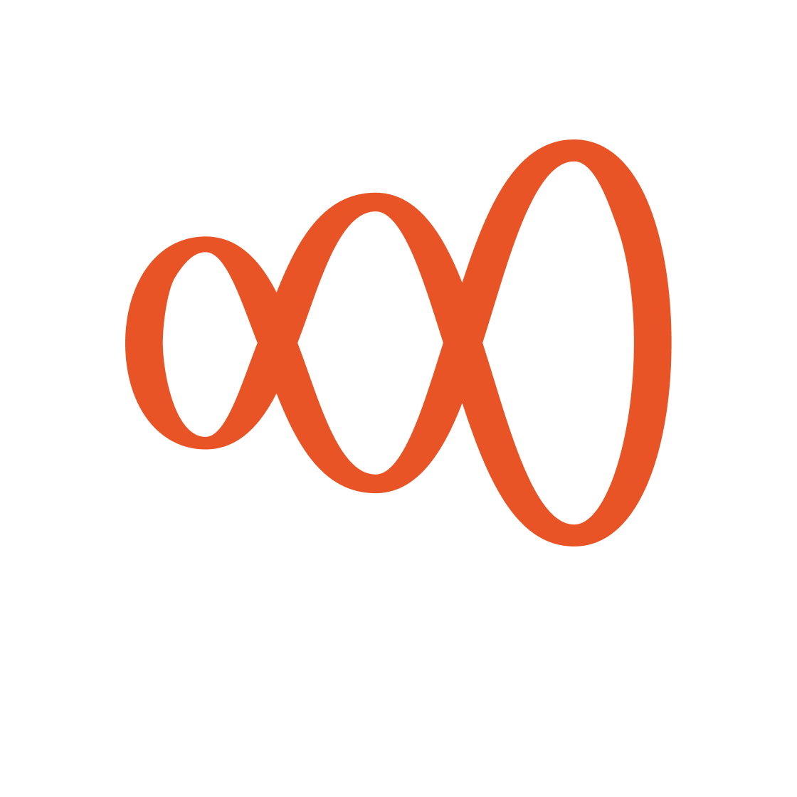

<p align="center">
  <a href="https://connexity.ai">
    
  </a>
</p>

<div align="center">
   <div>
      <h3>
         <a href="https://connexity.ai">
            <strong>Website</strong>
         </a> ·
         <a href="https://github.com/Connexity-AI/connexity">
            <strong>GitHub</strong>
         </a> ·
         <a href="./docs">
            <strong>Docs</strong>
         </a> ·
         <a href="https://discord.gg/QvWCX96J6K">
            <strong>Discord</strong>
         </a>
      </h3>
   </div>

   <div>
      <a href="https://connexity.ai/roadmap"><strong>Roadmap</strong></a> ·
      <a href="./docs"><strong>Documentation</strong></a> ·
      <a href="https://github.com/Connexity-AI/connexity/issues"><strong>Report Bug</strong></a> ·
      <a href="https://github.com/Connexity-AI/connexity/discussions"><strong>Feature Request</strong></a> ·
      <a href="https://github.com/Connexity-AI/connexity/commits/main"><strong>Changelog</strong></a>
   </div>
   <br/>
   <span>Connexity uses <a href="https://github.com/Connexity-AI/connexity/discussions"><strong>GitHub Discussions</strong></a> and <a href="https://discord.gg/QvWCX96J6K"><strong>Discord</strong></a> for support and feature requests.</span>
   <br/>
   <br/>
</div>

<p align="center">
   <a href="./LICENSE">
      
   </a>
   <a href="https://discord.gg/QvWCX96J6K" target="_blank">
      
   </a>
   <a href="https://connexity.ai" target="_blank">
      
   </a>
</p>

Connexity is where **an AI assistant runs operations for your voice AI agents, with people approving where it matters**. Your assistant (Claude Code, Claude or ChatGPT) watches, investigates and fixes. Connexity gives it what that job needs: every call recorded and checked, the issues found, the rules the agent should follow, tests it can run before a change ships, and the next task to work on. You step in when a decision is yours.

Connexity never edits, deploys or calls an agent. The assistant does the work through MCP; the web app is a dashboard for a quick look at how things stand.

It is open source and early. Retell is the voice platform connected today.

## What it does today

- **Records every call.** Calls of the agents you add are pulled from Retell on a schedule and stored as one timeline: what was said, each tool call with its arguments and result, and the agent version that served the call. Tool calls can be linked to the n8n execution behind them.
- **Checks every call.** Checks run on each stored call and group what they find into issues per agent, each marked as found by a rule or by a model. Issues can be marked fixed in a version, reopen if they happen again, and can be archived.
- **Keeps the spec.** The assistant writes each agent's spec: its rules in plain sentences, each with its source. Behaviour the spec does not settle becomes a question for you, and your answer becomes a rule.
- **Tests before a change ships.** The assistant writes scenarios linked to spec rules and runs them as simulated text calls on the agent's own engine (Retell today), with every tool faked. Each rule is judged Passed, Failed or Didn't come up, and a version that passes a full run is Verified.
- **Hands the assistant its next task.** Connexity sorts the work (setup, questions, issues, calls to review) and gives the assistant one task at a time; the Work page shows what it is doing and what waits for you.
- **Shows where you stand.** A dashboard with a score per agent and for the workspace, the Agents, Calls and Issues pages, an agent page with its spec and tests, and a single call with its recording and transcript.

## Connect your assistant

Sign up, then connect the assistant you already use. It reaches the workspaces you can reach and acts on your behalf.

- **Claude Code:** copy the setup prompt from Connexity and paste it into Claude Code.
- **Claude and ChatGPT:** add a custom connector with the MCP address and sign in.

Steps for each are in [`docs/connect-your-assistant.md`](./docs/connect-your-assistant.md). Every tool the assistant gets is listed on the public MCP page: [app.connexity.ai/mcp-docs](https://app.connexity.ai/mcp-docs).

Once connected, ask the assistant to set Connexity up: it connects Retell, adds the agents you choose, brings in their last 30 days of calls and writes their specs.

## Run it locally

You need Docker, [`uv`](https://docs.astral.sh/uv/) and [`pnpm`](https://pnpm.io/).

```bash
git clone https://github.com/Connexity-AI/connexity.git
cd connexity
cp .env.example .env   # set the secrets it names; a model key is needed for model checks and simulations

make install     # Python and frontend dependencies
make db          # Postgres in Docker
make db-upgrade  # migrations
make db-seed     # the first login, if FIRST_SUPERUSER is set in .env
```

Then, each in its own terminal:

```bash
make dev        # API on http://localhost:8000
make dashboard  # web app on http://localhost:3000
make mcp        # MCP server on http://localhost:8001
```

The MCP server needs two addresses in `.env` before it starts: `MCP_PUBLIC_BASE_URL=http://localhost:8001` and `MCP_OAUTH_ISSUER_URL=http://localhost:8000`.

Open the web app, sign in, and connect your assistant to `http://localhost:8001/mcp`. On a local run nothing pulls new calls on its own: the assistant brings calls in with the first scan, and the scheduled pull runs only where a Google Cloud Scheduler job is set up for it (see [`docs-internal/call-ingestion.md`](./docs-internal/call-ingestion.md)). To run the whole stack in Docker instead, see [`docs/self-hosting/docker-compose.md`](./docs/self-hosting/docker-compose.md).

## Docs

- [`docs/`](./docs): connecting an assistant, the trace format calls are stored in, and self-hosting.
- [`docs-internal/`](./docs-internal): how each part is designed and how the project is built, for contributors.
- [`CONTRIBUTING.md`](./CONTRIBUTING.md): development setup and what a pull request needs.

## 🌟 Star Us

If Connexity is useful to you, please star the repo on GitHub — it helps a lot.

<a href="https://github.com/Connexity-AI/connexity">
   
</a>

## 💬 Support

Finding an answer to your question:

- The [`docs/`](./docs) folder is the best place to start.
- [GitHub Discussions](https://github.com/Connexity-AI/connexity/discussions) — ask questions, share what you're building, and request features.
- [Discord](https://discord.gg/Gj47DqWq) — chat with the team and other users in real time.

Support channels:

- **Ask any question in our [GitHub Discussions](https://github.com/Connexity-AI/connexity/discussions).** Please include as much detail as possible (code snippets, screenshots, logs) so we can help quickly.
- [Request a feature](https://github.com/Connexity-AI/connexity/discussions) on GitHub Discussions.
- [Report a bug](https://github.com/Connexity-AI/connexity/issues) on GitHub Issues.
- For time-sensitive or private queries, email [dmitry@spacestep.ca](mailto:dmitry@spacestep.ca).

## 🤝 Contributing

Your contributions are welcome!

- Vote on ideas in [GitHub Discussions](https://github.com/Connexity-AI/connexity/discussions).
- Raise and comment on [Issues](https://github.com/Connexity-AI/connexity/issues).
- Open a PR — see [CONTRIBUTING.md](./CONTRIBUTING.md) for how to set up a development environment and what we expect in pull requests.

## 🥇 License

This repository is [MIT licensed](./LICENSE).
