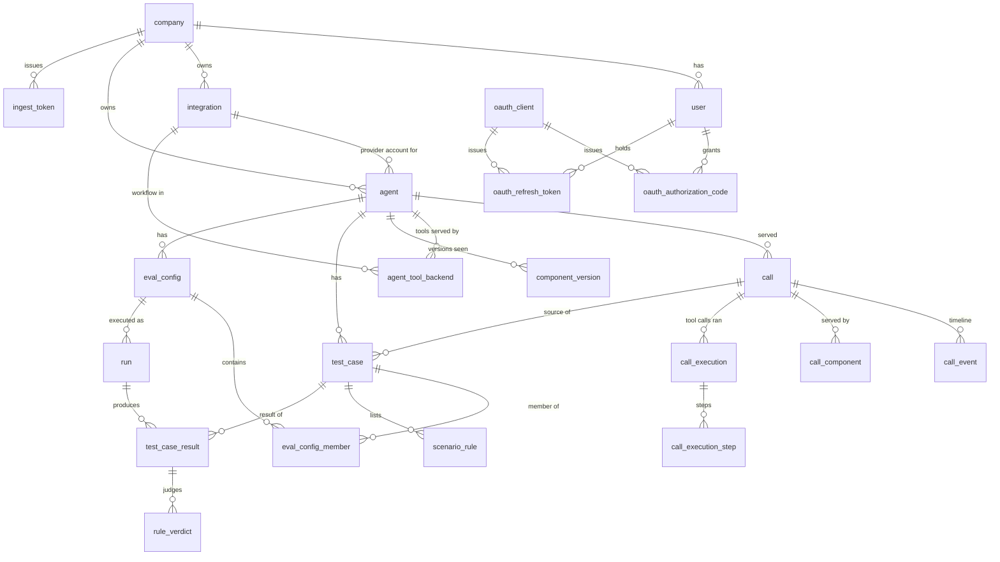

# Data model

The models in `backend/app/models/` are the single description of the schema. This page
is a map, not a column reference: read the model file for fields, and keep this page to
what the code cannot tell you (what each table is for and where it is heading).

A test (`test_models_match_migrated_schema`) fails when models and migrations disagree,
so the models are always what the database actually has.

## Tables

| Table | Model file | What it holds | Since |
|---|---|---|---|
| `company` | `company.py` | A tenant, with its LLM credentials (encrypted). | The start |
| `user` | `user.py` | A login. Each signup creates its own company. `session_version` (0046) is carried by every web session token; a password reset adds one, which ends the sessions issued before it. | The start |
| `integration` | `integration.py` | A provider account (Retell, Vapi, ElevenLabs) with an encrypted API key. This is the product's read access to a provider. | The start |
| `agent` | `agent.py` | A voice agent, linked to its agent on a voice platform. | The start |
| `call` | `call.py` | A call and the call-level fields of its trace (provider, source, end reason, parties, inputs, outputs), plus the provider's raw payload. | The pre-trace columns were dropped in slice 1.3; duration is derived from start and end |
| `call_event` | `call.py` | One row per trace event (utterance, tool call, marker), ordered within the call. The only stored form of the timeline. | New in slice 1.1 |
| `call_component` | `call.py` | One row per component that served a call, with its version and fingerprint. `call.agent_version` and `call.state_fingerprint` summarise them. | Filled for Retell since slice 1.5 |
| `call_execution` | `execution.py` | What a backend did for one tool call: one run of a workflow, tied to the call and the tool call's id in the trace. | New in slice 1.4 |
| `call_execution_step` | `execution.py` | One unit of work in an execution (an n8n node run), ordered, with its output. | New in slice 1.4 |
| `agent_tool_backend` | `integration.py` | Which workflow, in which n8n connection, serves one of an agent's tools. | New in slice 1.4 |
| `component_version` | `component_version.py` | The catalogue: one row per version of a component (agent settings, prompt, model, skill) seen for an agent, with a fingerprint and the content. | New in slice 1.5 |
| `finding` | `check.py` | One thing wrong at one moment in one call, raised by one version of one check. Points at trace events by their id, and keeps the effect (flags or fails) its check had when the call started. | New in slice 2.1 |
| `issue` | `check.py` | All findings with the same symptom on one agent: agent, check type and key. Open, resolved, reopened (found again after it was resolved) or archived (renamed from "regressed" and "accepted" with the Issues page, migration `0018`). When it was seen and how much it holds are read from its findings. Its last archive keeps when, "until it spikes" or forever, and the spike baseline (`0019`). Marked fixed, it keeps the version that carries the fix and when that version went live (`fix_live_at`, `0032`); it reopens only on a call from then on. | New in slice 2.3; fix going live in 10.13 |
| `call_check` | `check.py` | What one check did on one call the last time it was checked: ran, skipped (with what the call lacks), broke, off, or pending (a model check waiting for its answer). A call's status (failed, degraded, clean, unchecked) is read from this and its findings. | New in slice 2.3 |
| `usage_record` | `usage.py` | What a workspace used, in units: one row per real call (observed minutes) and per simulated call (simulated caller messages), with Connexity's own model cost and its token counts. Outlives its source. See [`usage.md`](./usage.md). | New in 0044 |
| `provider_cost_day` | `provider_cost.py` | What a model provider billed Connexity for a day and model, beside what Connexity recorded for it, in dollars and tokens by kind. Connexity's own account: no `company_id`, returned by no route. See [`usage.md`](./usage.md). | New in 0045 |
| `password_reset_request` | `password_reset.py` | One row per request to reset a password, for an account or not: hashes of the email asked for and of the caller's network address, the person when there is one, the hash of the link's token, when the link expires and when it was used or replaced. The limits are counted from these rows. No `company_id`: a person is not owned by one workspace. See [`password-reset.md`](./password-reset.md). | New in 0046 |
| `model_answer` | `model_answer.py` | What a model said when a model check (classifier or judge) asked it about a call: one row per call, check and version, with its tokens, cost and attempts. Labels keyed by event ids, never what was said. Re-checks read it; the daily model budget adds up its costs. | New in 10.14 |
| `decision_record` | `check.py` | Who decided what, when and why. Append only. A check's setting for an agent is its latest record; there is no table holding the current value. It names the assistant that acted with the person's approval, and `detail` holds an archive's duration or a spike's numbers; "Connexity" decided the ones it made itself. | New in slice 2.1 |
| `spec` | `spec.py` | One version of an agent's spec: its number per agent, the agent version and prompt fingerprint it was written for, whether it was written, adopted when the agent version changed, made by answers to clarifications, or marked (only rules' critical marks changed), the agent version its prompt rules were last written for (`written_for`: an adopted, answered or marked version keeps its predecessor's, so it still needs review), the version it follows, and who wrote it (person and assistant). The latest version is the agent's spec; older ones never change. | New in 10.11 part 1; origin `answered` and `written_for` in 10.12 part 1; origin `marked` in 10.12905 |
| `spec_rule` | `spec.py` | One rule of one spec version, in one plain sentence: its fixed category, its source (the prompt, with the words it rests on, or a clarification), whether it touches money, safety or compliance, whether it is critical (a failure stops a release; carried by key into later versions, and changing marks makes a version with origin `marked`), and a key that stays the same across versions. Rules are never edited; a change is a new spec version. A rule from a clarification is carried into every later version and changes only through another clarification that replaces it. | New in 10.11 part 1; `critical` in 10.12905 |
| `clarification` | `clarification.py` | A question about an agent's behaviour that its spec does not settle: two to four answers (a to d), each with the rule it becomes, the rule's category and `touches`, the calls where it was seen (ids, possibly none), the spec version it was raised against, optionally the rule it replaces, its state (open, answered or parked), the chosen answer (a letter, or "other" with the person's own words, which became the rule) and the spec version it made, and who raised and decided it. Answers for one agent, given together, make one spec version. Each answer, park and reopen is also a decision record. Connexity stores no answer suggested by an assistant (10.123). | New in 10.12 part 1; "other" in 10.128 |
| `assistant_task` | `assistant_task.py` | A task an assistant took from `get_next_task`: its key, kind and title, who took it (the person, the assistant and the session's name), and what became of it: in progress, waiting for the person (its part done, the rest theirs), returned to the list, or done. Tasks themselves are worked out from the workspace each time (`app/services/work.py`); rows are kept, never deleted. One row in progress or waiting per task. | New in 10.124; session name in 10.125 |
| `task_order` | `task_order.py` | The person's order of the assistant's tasks: one row per workspace, the To do keys as they last left them, and the last move (the task, who moved it and the assistant that acted, when). Connexity's order fills in every task not in it; blockers still sit above what they block. | New in 10.1271 |
| `check_release` | `check.py` | When each version of a built-in check was first present. Not owned by a company. A finding on a call that started earlier is retroactive. | New in slice 2.1 |
| `test_case` | `test_case.py` | A scenario: the stage for a simulated call. The caller (`persona_context`, `caller_goal`, `caller_behaviour`), what the caller knows (`user_context`) apart from the agent's variables (`agent_variables`), who speaks first and the first message, fake tool results (`expected_tool_calls` with `mock_response`), and optionally the call it came from. Written by the assistant through MCP; it has no pass or fail of its own. | Reshaped in 10.1291 (`caller_goal`, `caller_behaviour`, `agent_variables`) |
| `scenario_rule` | `scenario.py` | A spec rule a scenario expects to come up, by the rule's key, so the link holds across spec versions. A scenario with at least one is listed by MCP. | New in 10.1291 |
| `eval_config`, `eval_config_member` | `eval_config.py` | A named set of scenarios; `write_scenario_set` writes its members. | In use since 10.1291 |
| `run` | `run.py` | One run of scenarios against an agent version on its platform (10.1292). It has its `scope` (a set, a pick or all), `set_name`, `repeats`, the `spec_id` whose rules it judges, the `platform_version` it tests, the `version_fingerprint` of the content it tested (10.1293: results are grouped by both, since an unpublished version is edited under the same number) and a `status_detail`; its `eval_config_id` is empty for a pick or all. | Reshaped in 10.1292; old columns dropped in 10.198 |
| `test_case_result` | `test_case_result.py` | One simulated call in a run (a scenario and a repeat), made when the run starts, with the code-check findings in it (`check_findings`) and the tools that got the default fake (`default_fakes`); `passed` stays empty, since a scenario has no pass or fail. | Reshaped in 10.1292 |
| `rule_verdict` | `test_run.py` | A rule the scenario lists, judged in one simulated call: Passed, Failed or Didn't come up, with the reason, the turns, and whether the rule was critical in the run's spec version. | New in 10.1292 |
| `ingest_token` | `ingest_token.py` | A company's credential for sending traces. Only a hash of the token is stored. | New in slice 1.2 |
| `oauth_client`, `oauth_authorization_code`, `oauth_refresh_token` | `oauth.py` | The OAuth server that MCP clients authenticate against. | The start |

## Conventions

- **Tenancy.** Every tenant-owned table has `company_id`, and every query filters on it.
- **Enums** are VARCHAR columns holding the member's value, declared with
  `enum_type(...)` from `app/models/columns.py`. No Postgres ENUM types.
- **Structured values** that are read and written as a whole live in JSONB columns
  with a Pydantic model in `schemas.py` (run config, transcript turns).
- **A trace is stored once, as rows.** The JSON in
  [`docs/traces/trace-schema.md`](../docs/traces/trace-schema.md) is the wire format;
  `app/crud/trace.py` stores it as call columns, event rows and component rows and
  assembles it on read. There is no stored trace document.
- **Deleting a call** cascades to its events and components in the database.
- **Soft delete** (`deleted_at`) is used on calls, test cases and eval configs.
- **Constraints live on the model.** Indexes, partial indexes and `ondelete` rules are
  declared on the model, never in a migration only. See
  [`migrations.md`](./migrations.md).

## What a run tested

A run records the agent's version on its platform (`platform_version`) and a
fingerprint of that version's content (`version_fingerprint`), both read from the
platform before the run is stored. A result therefore always shows what was actually
tested, even after the agent changes.

